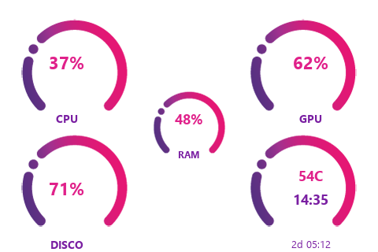
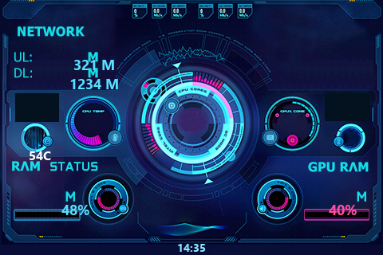
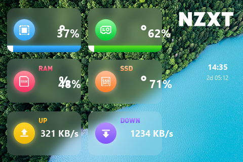

<div align="center">

# UsbMonitor Reborn

**Substituto moderno, em código aberto, para o app das telas USB IPS de 3,5" de monitoramento de sistema.**

Mostre CPU, GPU, RAM, disco, rede, uptime e relógio numa telinha USB, com temas bonitos e uma interface limpa.

[](https://www.python.org/)
[](https://doc.qt.io/qtforpython/)
[](#requisitos)
[](#licença)

</div>

---

## Sobre

As telas USB de 3,5" vendidas como "sub-monitor" de sistema (muitas como acessório para AIDA64)
vêm com um software proprietário antigo, limitado e fechado. O **UsbMonitor Reborn** é uma
reimplementação livre: fala direto com a tela, lê os sensores do PC e desenha painéis
personalizáveis, com interface moderna em PySide6.

Hardware alvo: painel **Turing Smart Screen Revisão A**, identificado pelo serial
`USB35INCHIPSV2` (chip serial WCH, `VID 1A86` / `PID 5722`). A tela aparece no Windows como
porta serial USB (COM virtual). Resolução 480x320 (paisagem) ou 320x480 (retrato).

## Recursos

- **Comunicação direta com a tela** via protocolo serial Rev A (115200 baud, pixels RGB565).
- **Sensores reais**: uso e frequência de CPU, GPU NVIDIA (uso, temperatura, VRAM, fan via NVML),
  RAM, disco, throughput de rede por adaptador, uptime e relógio.
- **8 temas prontos**, incluindo recriações fiéis dos temas clássicos do fornecedor
  (Gradient, MagicBlue, NZXT) a partir das artes originais.
- **Temas em JSON editável** com widgets posicionáveis (texto, rótulo, barra, anel, relógio).
- **Interface moderna**: preview ao vivo, galeria visual de temas, controle de brilho,
  orientação, taxa de atualização, seleção de disco e de adaptador de rede.
- **Recuperador de retenção de imagem** para dissolver marcas fantasma no painel.
- **Bandeja do sistema** e **iniciar com o Windows**.

## Galeria de temas

| | | |
|:---:|:---:|:---:|
|  |  |  |
| **Gradient** | **MagicBlue** | **NZXT** |
|  |  |  |
| **Gamer Neon** | **Minimal Claro** | **Foco GPU** |

## Status do projeto

Funcional e testado no hardware real. O que já está pronto, o que foi usado e o que falta
está em [docs/STATUS.md](docs/STATUS.md). O planejamento em sprints está em
[docs/ROADMAP-SPRINTS.md](docs/ROADMAP-SPRINTS.md).

Próximo passo em destaque: **editor visual de temas**, para montar dashboards e escolher
imagens de fundo pela interface.

## Tecnologias

| Área | Tecnologia |
|---|---|
| Linguagem | Python 3.12 |
| Interface | PySide6 (Qt) |
| Renderização | Pillow |
| Sensores | psutil, nvidia-ml-py (NVML) |
| Comunicação | pyserial |
| Iniciar com Windows | winreg |

## Requisitos

- Windows 10 ou 11.
- Python 3.12 ou superior.
- Uma tela compatível (Turing Smart Screen Rev A / `USB35INCHIPSV2`).
- Para sensores de GPU: placa NVIDIA (usa NVML). Outras GPUs mostram os campos disponíveis.

## Instalação

```bash
git clone https://github.com/<seu-usuario>/usbmonitor-reborn.git
cd usbmonitor-reborn
python -m venv .venv
.venv\Scripts\activate
pip install -r requirements.txt
```

## Uso

1. Feche o software original da tela (ele mantém a porta COM ocupada).
2. Inicie o app:
   ```bash
   .venv\Scripts\python.exe app.py
   ```
   No Windows, também dá para usar o atalho `UsbMonitor Reborn.bat` (abre sem console).
3. A porta da tela é detectada sozinha. Clique em **Conectar**.
4. Escolha um tema na galeria e ajuste orientação, brilho, disco e adaptador de rede.

## Formato de tema

Cada tema é um arquivo JSON em `themes/`. Estrutura resumida:

```json
{
  "name": "Meu Tema",
  "width": 480,
  "height": 320,
  "background_color": "#0C0E1C",
  "background_image": "assets/backgrounds/fundo.png",
  "widgets": [
    { "type": "clock", "x": 20, "y": 12, "field": "clock", "size": 44, "color": "#00E6FF" },
    { "type": "bar", "x": 240, "y": 92, "field": "cpu_percent", "width": 210, "fill_color": "#00C8FF" }
  ]
}
```

Tipos de widget: `text`, `label`, `clock`, `bar`, `ring`. Campos de sensor disponíveis:
`cpu_percent`, `cpu_freq_mhz`, `cpu_temp_c`, `ram_percent`, `gpu_percent`, `gpu_temp_c`,
`gpu_mem_percent`, `gpu_fan_percent`, `gpu_name`, `disk_percent`, `net_up_kbps`,
`net_down_kbps`, `uptime`, `clock`, `date`. Veja [docs/TEMAS.md](docs/TEMAS.md) para a
referência completa.

## Arquitetura

```
driver/turing_screen.py   Protocolo serial da tela (Rev A, RGB565)
core/sensors.py           Leitura de CPU, GPU, RAM, disco, rede, uptime
core/theme.py             Modelo de tema (JSON) e widgets
core/theme_presets.py     Temas prontos
core/renderer.py          Desenha tema + leitura numa imagem PIL
core/engine.py            Loop em thread: sensores -> render -> tela
ui/                       Interface PySide6 (janela, galeria, widgets)
app.py                    Ponto de entrada
```

Detalhes do protocolo em [docs/PROTOCOLO.md](docs/PROTOCOLO.md) e da arquitetura em
[docs/ARQUITETURA.md](docs/ARQUITETURA.md).

## Limitações

- A tela tem um teto de banda de ~128 KB/s no firmware. Em tela cheia (480x320) isso dá
  cerca de 0,4 quadro por segundo, então **vídeo fluido não é possível**; o ideal é 1 atualização
  por segundo para painéis de sensores.
- Temperatura de CPU no Windows não é exposta pelo `psutil`; depende de integração futura
  com LibreHardwareMonitor (ver [roadmap](#roadmap)).

## Roadmap

- [ ] Temperatura e fans de CPU via LibreHardwareMonitor.
- [ ] Editor visual de temas (arrastar e soltar widgets).
- [ ] Widget de clima e mais fontes de sensor.
- [ ] Empacotar como executável único (PyInstaller).

## Créditos

O protocolo da tela foi reimplementado a partir da especificação pública mantida pela
comunidade no projeto [turing-smart-screen-python](https://github.com/mathoudebine/turing-smart-screen-python)
(GPL-3.0). As artes dos temas Gradient, MagicBlue e NZXT foram extraídas do software
original do fornecedor para interoperabilidade.

## Aviso legal

Projeto independente, sem vínculo com os fabricantes das telas nem com a NZXT. Use apenas
com hardware que você possui. Nomes e marcas citados pertencem aos respectivos donos.

## Licença

Distribuído sob a **GPL-3.0**, por compatibilidade com a base de protocolo da comunidade.
Veja [LICENSE](LICENSE).
